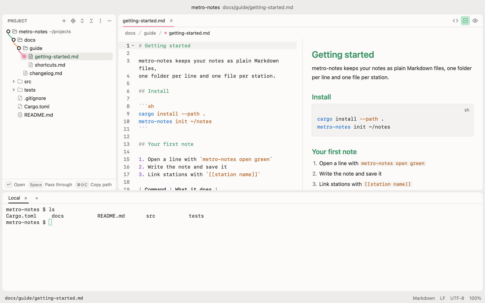

# subwy

A light, fast, keyboard-first text and Markdown editor for macOS, written in Rust.

Open a folder, walk its tree with the arrow keys (the way to the selection is drawn as a metro
line, and glides as you move), copy paths in one keystroke, and read Markdown and code with
syntax highlighting, with your shell a keystroke away. An editor, not an IDE: no
language servers or plugins.

Early days: macOS only, built from source.

<picture>
  <source media="(prefers-color-scheme: dark)" srcset="assets/screenshots/main-dark.png">
  
</picture>

## Performance

Measured on an Apple M1 Pro (32 GB), macOS 15.5, with subwy 0.1.0 (release build), a small
project open, one Markdown file beside its preview and the terminal open. Median of five launches.

| | subwy |
|---|---|
| Download (DMG) | 10.3 MB |
| On disk | 33 MB |
| Launch to first window | 0.36 s (1.1 s for the first launch after a build) |
| Memory, 5 s after launch | 60 MB |
| CPU while idle | under 1% |

Launch is timed from process start until the window is on screen; memory is the process's
physical footprint (`footprint`, what Activity Monitor shows as Memory); idle CPU is CPU time over
10 seconds.

## Build and run

You need macOS and Rust (the toolchain in `rust-toolchain.toml` is picked up automatically).
The Xcode Command Line Tools are enough; shaders compile when the app starts.

```bash
cargo run --release -p subwy -- ~/notes          # open a folder
cargo run --release -p subwy -- ~/notes/todo.md  # open a file in its folder
```

Without an argument subwy reopens the windows you left, each with its folders, tree and tabs.

A window can hold several folders: add one with `Cmd+O`
(This Window) or the tree's more menu (Add Folder…), and take it out with Remove from Window on its
row's right-click menu. Copied relative paths are relative to the file's own folder.

## Install

There is no download yet; build the app from source:

```bash
scripts/bundle.sh         # target/bundle/subwy.app
scripts/bundle.sh --dmg   # also target/bundle/subwy-<version>.dmg
```

Copy `target/bundle/subwy.app` to `/Applications` (or open the DMG and drag it there).
Then Finder's Open With and `open -a subwy <folder or file>` open in subwy, a new window per folder.
The app is signed ad hoc, which is enough on the Mac that built it; giving it to others would need
a Developer ID signature and notarization.

### The `subwy` command

`scripts/subwy` opens folders and files from a terminal, starting subwy or handing them to the one
already running:

```bash
subwy ~/notes            # the folder, in the window that has it or a new one
subwy ~/notes/todo.md    # the file, in its folder's window
subwy                    # start subwy, or bring it forward
```

To have it on your `PATH`, link it into a folder that is on `PATH`, from the repository root:

```bash
mkdir -p ~/.local/bin
ln -s "$PWD/scripts/subwy" ~/.local/bin/subwy
```

It opens `target/bundle/subwy.app` from this repository when that exists, else the `subwy.app`
macOS knows about (the one in `/Applications`). Set `SUBWY_APP=/path/to/subwy.app` to choose another.

## Keys

| Where | Keys | What |
|---|---|---|
| Anywhere | `Cmd+O` | Open a folder (a window with folders asks: add it to this window, or open a new one) |
| | `Cmd+Shift+N` | New window |
| | `Cmd+1` | Focus the tree (again: hide it) |
| | `Cmd+Shift+O` | Find a file by name |
| | `Cmd+Shift+C` | Copy the absolute path |
| | `Cmd+Alt+Shift+C` | Copy the relative path; in the editor with the line, `docs/a.md:12` or `:12-18` |
| | `Cmd+Alt+R` | Reveal in Finder |
| | `Cmd+S`, `Cmd+W` | Save, close the tab |
| | `Cmd+Shift+[` / `]` | Previous / next tab |
| | `Cmd+Shift+V` | Markdown preview beside the editor (the buttons at the tab bar's right also show the preview alone; drag the line between them) |
| | `Cmd+=`, `Cmd+-`, `Cmd+0` | Zoom in, out, back to 100% |
| | `Alt+F12` | Focus the terminal, which opens with the folder (in the terminal: hide it, the shell keeps running) |
| | `Cmd+T` | New terminal tab |
| Tree | `Up`, `Down`, `Home`, `End`, `PageUp`, `PageDown` | Move |
| | `Right` / `Left` | Open a folder or step in / close it or step out |
| | `Shift+Up` / `Shift+Down`, `Shift`-click, `Cmd`-click | Select several rows; copying, `Enter` and the Trash take them all |
| | `Enter` | Open the file (or toggle the folder) |
| | `Space` | Pass through: show the file and stay in the tree |
| | type letters, `Cmd+F` | Jump to a name |
| | `Cmd+N`, `Shift+F6`, `Cmd+Backspace` | New file or folder (pick in the popup, `F` / `D`), rename, move to the Trash |
| | `Cmd+X`, `Cmd+C`, `Cmd+V` | Cut or copy the selected items, paste them into the selected folder (files copied in Finder paste too; a taken name gets ` copy`, nothing is replaced) |
| | `F5`, `F6` | Copy or move the selected items to the path typed on the line under the tree (a new name, or a folder ending in `/`) |
| | drag | Rows onto a folder move there (hold `Option` to copy); onto the editor they open, onto the terminal their paths are typed. Files from Finder are copied into the folder they are dropped on |
| | right-click | The row's menu: new file or folder, cut, copy, paste, copy the path or the name, rename, copy to, move to, trash, reveal in Finder, open in the terminal (arrows and `Enter` pick) |
| | `Esc` | Back to the editor |
| Terminal | `Cmd+C`, `Cmd+V` | Copy the selection, paste |
| | `Cmd+W`, `Cmd+Shift+[` / `]` | Close the terminal tab, previous / next terminal tab |
| Markdown | `Enter`, `Tab`, `Shift+Tab` | Continue a list, indent or outdent a list item |
| | `Cmd+B`, `Cmd+I` | Bold, italic |

## Settings

subwy writes `~/Library/Application Support/subwy/settings.json` with the defaults on first run.
Changes apply the next time subwy starts.

```json
{
  "editor_font": "SF Mono",
  "editor_font_size": 13.0,
  "tab_size": 4,
  "soft_wrap": "markdown",
  "key_hints": true,
  "keymap": [
    { "key": "cmd-p", "action": "workspace::ToggleFinder", "context": "Workspace" }
  ]
}
```

`soft_wrap` is `markdown`, `all` or `none`. Entries in `keymap` are added after subwy's own keys, so they win.
A file that does not parse is ignored (with the reason in the status bar) and the defaults are used.

## Development

```bash
cargo test --workspace   # unit tests, plus offscreen UI checks that save screenshots to target/visual/
cargo clippy --workspace --all-targets -- -D warnings
cargo fmt --all --check
```

The UI checks (`crates/app/tests/visual/`) build the real window off screen, type keys into it and
check what happens, without showing a window or taking the keyboard.

`crates/project` holds the rules that need no UI (the tree, keyboard moves, copied paths, file I/O,
session and settings); `crates/app` is the window.

## License

[MIT](LICENSE)
